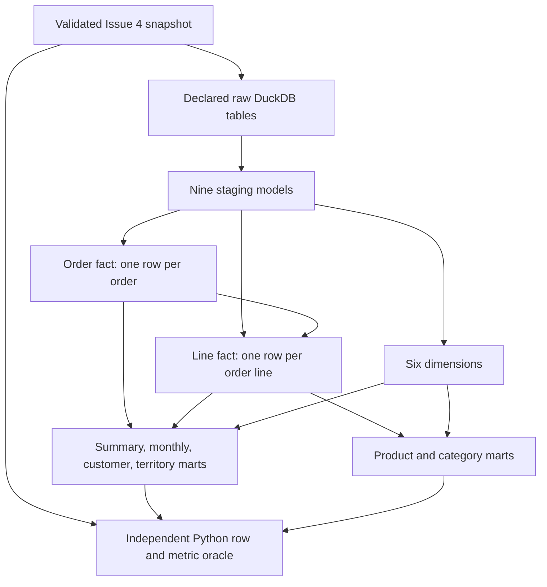

# AdventureWorks dimensional analytics

Issue #5 adds a separate dbt project in `dbt/adventureworks/`. It consumes the
validated Issue #4 Parquet snapshot without connecting to SQL Server. The original
`dbt/` synthetic project, runner, fixture semantics and tests remain intact.

## Reproduce

Use Python 3.13 and the pinned environment from `requirements.lock`. From the
repository root, with an existing Issue #4 snapshot and `current.json`:

```powershell
.venv/Scripts/python.exe -m src.analytics
.venv/Scripts/python.exe -m src.analytics_check
.venv/Scripts/python.exe -m unittest discover -s tests -v
```

On Linux use `.venv/bin/python`. Optional `--snapshot-root PATH` and
`--output-root PATH` select a snapshot collection and a local output directory.
The current pointer is pinned at the start of each run. To reproduce a historical
snapshot, use a separate local collection with that snapshot and its original
`current.json` values; never edit an immutable source manifest to change identity.

The runner checks the current pointer's manifest SHA-256 and input fingerprint,
then performs complete Issue #4 schema/content/financial validation. It loads
declared DuckDB tables in schema `raw`, runs `dbt build`, and independently
reconstructs **every model row and mart metric** from the Parquet records in Python.
It validates source integrity again before publication. There are no database
credentials, Docker calls, SQL Server writes, restores or downloads in this path.

An analytical run is published under `output/analytics/RUN_ID/` with:

- `analytics.duckdb`: the typed raw copy and 23 models.
- `evidence.json`: snapshot identity/hash/fingerprint, code revision/dirty state,
  dependency versions, dbt result counts, model row counts and deterministic content
  hashes, reconciled eligible totals and limitations.
- `dbt-target/manifest.json` and `run_results.json`: dbt lineage and test evidence.
- Local dbt logs for diagnosis.

An exclusive publication lock and unique staging directory protect the run.
Only a passing run replaces `output/analytics/current.json`, which records the run
ID and SHA-256 of the evidence and database. Previous validated runs are retained.
Failed dbt logs/results are retained separately; invalid databases are removed.
Crashes can leave stale locks/staging files; investigate before manually removing
only the abandoned run. Atomic filesystem publication is not a power-loss or
network-filesystem guarantee. Do not modify a published DuckDB file in place.

For inspection, open it read-only:

```python
import json
from pathlib import Path
import duckdb
from src.extract import digest

root = Path('output/analytics')
pointer = json.loads((root / 'current.json').read_text())
run = root / pointer['run_id']
assert digest(run / 'evidence.json') == pointer['evidence_sha256']
assert digest(run / 'analytics.duckdb') == pointer['database_sha256']
with duckdb.connect(str(run / 'analytics.duckdb'), read_only=True) as con:
    print(con.execute('select * from mart_sales_summary').fetchall())
```

## Model inventory and lineage

Every staging model preserves all selected source rows, statuses, timestamps,
nulls and monetary scales. Names become snake_case; source `Group` becomes
`territory_group`. Source columns/types are declared in the dbt source YAML and
Issue #4 extraction contracts; all 23 model schemas have enforced dbt contracts.

| Model | Grain / key | Purpose and source |
| --- | --- | --- |
| stg_sales_order_header | SalesOrderID | Typed header dates, context, financial amounts; Sales.SalesOrderHeader |
| stg_sales_order_detail | SalesOrderID + SalesOrderDetailID | Typed quantity, price, discount and amount; Sales.SalesOrderDetail |
| stg_customer | CustomerID | Person/store identifiers and current territory; Sales.Customer |
| stg_sales_territory | TerritoryID | Name, country and group; Sales.SalesTerritory |
| stg_product | ProductID | Product identifiers, attributes, current prices/cost and lifecycle dates; Production.Product |
| stg_product_subcategory | ProductSubcategoryID | Category relationship and name; Production.ProductSubcategory |
| stg_product_category | ProductCategoryID | Category name; Production.ProductCategory |
| stg_special_offer | SpecialOfferID | Offer description, percentage and validity; Sales.SpecialOffer |
| stg_special_offer_product | SpecialOfferID + ProductID | Valid offer/product pairs; Sales.SpecialOfferProduct |
| dim_customer | customer_key = CustomerID | Current person/store classification and current territory; stg_customer |
| dim_product | product_key = ProductID | Current attributes, flattened subcategory and category link; stg_product + stg_product_subcategory |
| dim_product_category | category_key = ProductCategoryID, plus -1 | Current taxonomy and explicit Uncategorized member; stg_product_category |
| dim_territory | territory_key = TerritoryID, plus -1 | Territory attributes and explicit Unknown member; stg_sales_territory |
| dim_date | date_key = YYYYMMDD | Dense calendar over the inclusive order-date range; stg_sales_order_header |
| dim_promotion | promotion_key = SpecialOfferID | Source offer attributes, including the no-discount offer; stg_special_offer |
| fct_sales_orders | sales_order_id | All orders, header money, date/customer/order-territory keys and eligibility; stg_sales_order_header |
| fct_sales_order_lines | sales_order_id + sales_order_detail_id | All lines, units and line money, dimension keys and eligibility; detail joined once to order fact |
| mart_sales_summary | summary_key = 1 | Eligible order and line totals, including zero-count summary for an empty eligible set |
| mart_sales_monthly | sales_month | Eligible metrics by order calendar month |
| mart_sales_customer | customer_key | Eligible metrics by customer with sales |
| mart_sales_territory | territory_key | Eligible metrics by order territory with sales |
| mart_sales_product | product_key | Eligible distinct orders, units and line sales by product with sales |
| mart_sales_category | category_key | Eligible distinct orders, units and line sales by current category with sales |



Native stable source identifiers are retained rather than replaced with hashes.
The date key is a deterministic calendar key. Reserved `-1` members represent
only **nullable** category/territory relationships; invalid non-null source keys
fail snapshot validation and relationships tests. Null territory remains distinct
from a named territory. Customer's current territory does not override the order's
territory. Customer person/store identifiers are not names or an inferred company
identity. Product subcategories are flattened rather than creating an unnecessary
additional dimension. The offer/product bridge remains staging data and validates
the composite relationship; offer ID alone does not establish product eligibility.

Dimensions represent attributes **as present in the extracted snapshot**. There
is no SCD history or effective-dated attribution. Historical sales grouped by
category use that snapshot's current taxonomy. Standard cost/list price are labeled
current and are not used to compute historical sales cost or margin.

## Metric contract

Facts and staging retain all statuses. Marts explicitly use `Status = 5` (shipped).
AdventureWorks status values are 1 in process, 2 approved, 3 backordered, 4 rejected,
5 shipped, 6 canceled, as defined in the sample's [source installation script](https://github.com/microsoft/sql-server-samples/blob/master/samples/databases/adventure-works/oltp-install-script/instawdb.sql).
No implicit exclusion by customer, channel, product, promotion or date is applied.
The offline fixture includes canceled orders to test that the metric filter is real.
There is no returns/refunds model or recognized-revenue interpretation.

| Metric | SQL definition / grain |
| --- | --- |
| Order count | `count(*)` on eligible order fact; product/category use `count(distinct sales_order_id)` within the group |
| Units sold | `sum(quantity)` on eligible line fact |
| Net line sales | `sum(net_line_sales)`, where each line preserves source LineTotal; excludes tax/freight |
| Header subtotal | `sum(subtotal)` on eligible order fact, retaining scale 4 |
| Tax / freight / total due | Separate `sum` on eligible order fact; never summed after joining detail |
| Average order value | Header subtotal / eligible order count, rounded half away from zero to four decimals; NULL for zero orders |
| Sales by month | Group by first day of the Gregorian month of the source order date |
| Sales by customer / territory | Same eligible amounts grouped by customer or **order** territory key |
| Sales by product / category | Eligible line sales and units grouped by product/current category; no allocation of header money |

Order timestamps are timezone-free SQL Server wall-clock values. Calendar
derivation performs no timezone conversion; year/quarter/month are Gregorian,
and ISO day-of-week uses Monday=1. The date dimension spans order dates only;
due/shipped timestamps remain facts rather than claiming complete role-playing
calendar coverage. Monthly marts contain months with eligible orders, not a
zero-filled reporting calendar.

`money` values remain decimal(19,4), line amounts decimal(38,6), aggregate header
amounts decimal(38,4), and aggregate line amounts decimal(38,6). AOV uses scaled
integer division in a dbt macro, avoiding DuckDB's floating-point `/` intermediary;
Python independently uses Decimal division and explicit rounding. Group AOVs are
ratios and must not be summed or averaged without weighting.

Header and line amounts are aggregated separately before their mart join. Each
order's summed six-decimal lines is rounded **once per order** to four decimals
and reconciled exactly to its header subtotal. The global line sum and global
header subtotal therefore deliberately remain different values; neither is forced
to match the other by rounding all lines or the grand total. Product/category
order counts overlap when an order contains multiple groups and are not additive.

Amounts are source monetary units. The nine-table snapshot contract does not
establish a currency denomination/conversion policy. No currency symbol, conversion
or cross-currency economic interpretation is supplied. Establishing a reporting
currency may require a separately approved extraction-contract expansion.

## Validation and automation

dbt tests check source/model keys and non-null keys, relationships, the composite
offer/product pair, source-to-model row counts, dense date cardinality, fact key-set
preservation, dimensional uniqueness, line/header equations, eligibility propagation,
and aggregate mart controls. Enforced model contracts check names/order/types.
The independent Python oracle reads original Parquet records and checks every
staging row, dimension attribute, fact row, eligibility flag and grouped mart
metric—including per-group order count and AOV—without using dbt outputs as its
expected-value source. It also enforces expected model grain and schema.

`python -m src.analytics_check` runs two full builds from the same existing source
snapshot, compares all 23 model content hashes and totals, then corrupts **local
copies** of the analytical database. Five targeted scenarios must fail both Python
validation and the exact selected dbt test: duplicate fact, missing customer
dimension, changed line amount, duplicate product dimension and changed summary.
These tests never alter source snapshots or published analytical databases.

Offline unittest fixtures also test canceled eligibility, unknown relationships,
halfway AOV rounding, no eligible orders, manifest tampering, and failed-publication
preservation. CI discovers these small local-Parquet tests without SQL Server,
Docker, credentials, dbt packages, or private datasets. It retains the existing
synthetic positive/repeatability/negative checks. Real-source evidence is local and
separately labeled; offline CI does not prove a real-source run.

## Evidence and remaining scope

See [local validation results](issue-5-validation.md). Generated snapshots,
DuckDB files, dbt manifests and analytical evidence remain ignored and local.
Existing acquisition, dataset licensing/provenance and publication restrictions
from [Issue #4](adventureworks-extraction.md#licensing-and-redistribution) still apply.

Issue #6 can expand regression coverage, evidence retention and automation; #7 can
select/report business requirements and deliver dashboards over these contracts;
#8 can publish the reproducible technical/business narrative. This milestone does
not implement dashboard delivery, historical dimensions, margin, revenue recognition,
currency conversion, large-dataset streaming or production orchestration.
