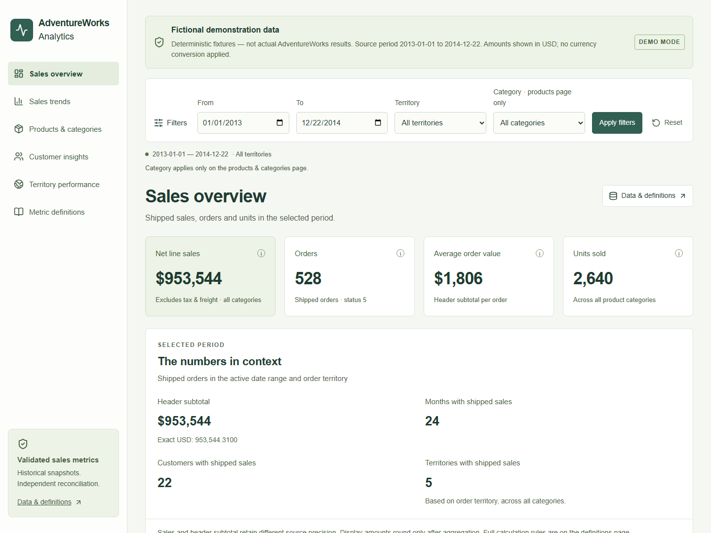
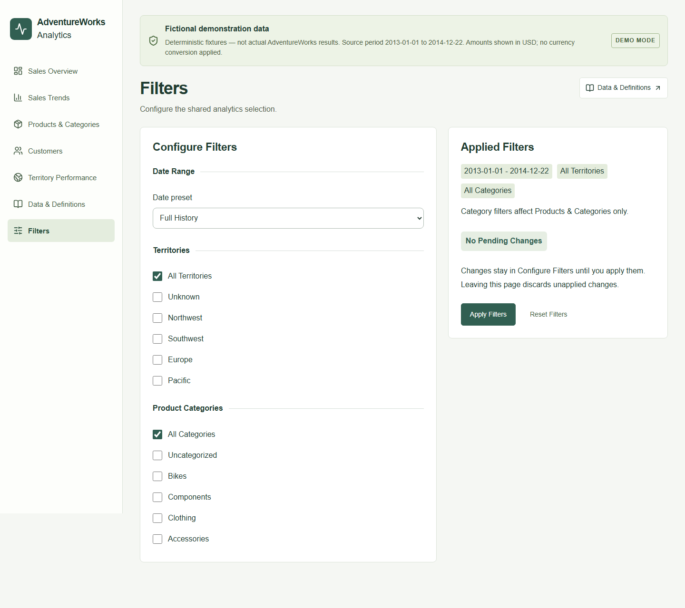
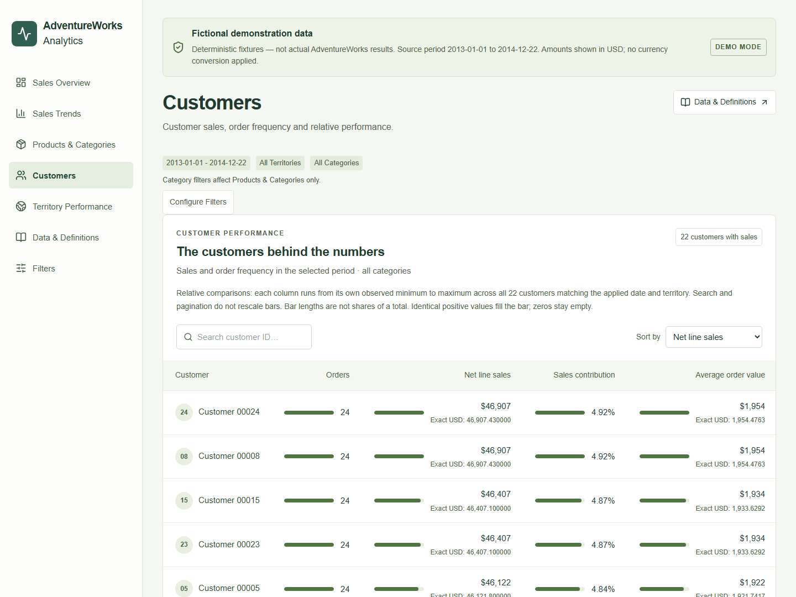
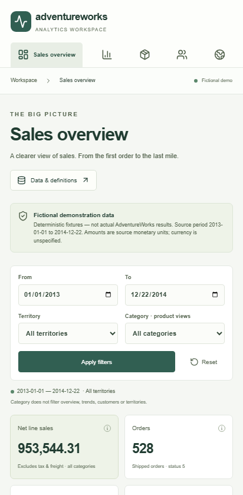

# Sales analytics dashboard

Issue #7 adds a local Next.js App Router application in `apps/web`. It uses React,
TypeScript, Tailwind CSS and Recharts. Native labeled controls and small typed
components serve this dashboard without a component framework or dashboard engine.
The public Vercel deployment serves the reviewed, pinned AdventureWorks 2022-derived aggregate (PR #17; Issue #16 completed). The fictional fixture remains for local tests and historical screenshots. No authentication, persistence, arbitrary uploads/SQL, scheduled refresh,
custom metrics or multi-tenancy are implemented.



## Start from a clean checkout

Use Node.js 22 (tested local version recorded in the validation report):

```powershell
cd apps/web
npm ci
npm run dev
```

Open the printed loopback URL. The checked-in `data/demo.json` is **fictional**:
576 deterministic orders over January 2013–December 2014, including canceled
orders that are excluded from the reported metrics. It was generated through
read-only-provider snapshot extraction, the actual 23-model/97-test dbt build,
independent Python reconciliation, and the dashboard export. It contains no
AdventureWorks source records or real-derived dataset. The browser identifies
demo mode throughout; these are not historical AdventureWorks business results.
No Python, SQL Server, Docker, credentials or external runtime service is needed
to launch the demo. Package and Playwright browser installation requires downloads.
The app loads no web fonts, external imagery, analytics or third-party data feeds.

For a production build **locally**:

```powershell
npm run build
npm run start
```

Both scripts bind to `127.0.0.1`. The approved public Production deployment is https://adventureworks-analytics-flax.vercel.app/.
Production on this branch requires the fixed `data/adventureworks2022.json`, pinned full-file/content hashes and snapshot, and `real_adventureworks` mode. It ignores `AW_DASHBOARD_DATA` and fails closed if the artifact is absent or unexpected. The exact artifact was approved, merged and deployed; future replacements and deployments require separate approval; see [artifact review](dashboard-artifact-review.md). Local export
overrides are supported only outside production; use `npm run dev` for them.
Do not run a build while a test or production server is using that same `.next`
output; stop that owned process first. The dev server uses `.next/dev`.

## Architecture and data boundary

```text
Validated immutable DuckDB run + evidence + original Parquet snapshot
  -> Python revalidates provenance, hashes and all 23 models independently
  -> daily filter-safe cells, reconciled against every row of all six marts
  -> version 1 JSON export (exact decimal strings, dimensions, provenance, hash)
  -> Next server: schema/hash/grain/FK checks, validated filters, exact composition
  -> typed response -> KPI/chart/table components
```

Presentation components live in `components/`, metric labels/formatting in
`lib/format.ts`, and AdventureWorks-specific access/composition in `lib/data.ts`.
Node filesystem access remains on the server. The client receives only shaped
responses, not the raw daily export. There is no runtime DuckDB or Python process
inside Next.js, and no source database connection. The JSON input is configured
on the server; components contain no machine-specific paths. The server and
`/api/dashboard` use the same typed data-access function. A configured missing or
invalid real export produces an error; it never silently falls back to demo data.

The existing marts each have one reporting grain and cannot be joined together
to obtain arbitrary date/territory/category combinations. The exporter therefore
uses the **already validated facts and dimensions** to produce three explicit
disjoint cell sets, then regroups and reconciles them to the six existing marts:

| Cell set | Grain / key | Measures |
| --- | --- | --- |
| Customer | Calendar date + order territory + customer | Orders, units, line sales, header subtotal/tax/freight/total due |
| Product | Calendar date + order territory + product | Distinct orders within product, units, line sales |
| Category | Calendar date + order territory + category | Distinct orders within category, units, line sales |

Headers and lines are aggregated separately before a one-to-one customer-cell
join. Orders belong to exactly one date/territory/customer cell. Thus date and
territory selections sum disjoint cells without header fan-out. Product/category
counts are computed separately with distinct order IDs: counts across products
or categories overlap and must never be added together. AOV is recomputed from
summed header subtotal and order count, never averaged from cell-level ratios.

All amounts cross JSON as decimal strings. The server sums scaled integers using
BigInt and rounds AOV half away from zero at four decimals, matching the existing
metric contract. UI headlines and ranked sales/AOV amounts round to zero decimals with en-US grouping;
expanded monetary tables also use zero-decimal USD. Exact source scales remain
in API values, KPI descriptions, chart tooltip details and amount-cell titles. USD presentation follows the reviewed [currency interpretation](currency-interpretation.md):
native AdventureWorks sample amounts, with no currency conversion applied.
SQL Server rate relationships and matching native prices support the interpretation;
Microsoft's OLTP schema does not explicitly label every monetary column USD.
Only chart coordinates/bar lengths use approximate JavaScript
numbers. Customer contribution is the customer's net line sales divided by the
selected all-category line-sales total, rounded to two percentage decimals.

## Pages and navigation

The shared responsive layout uses Next Link navigation with the active page
identified by `aria-current`. All page headings, navigation labels and browser
titles use the names below. Analytics pages show a compact applied selection
and a Configure Filters link; the full form exists only on `/filters`.

| Route | Page |
| --- | --- |
| `/` | Sales Overview |
| `/trends` | Sales Trends |
| `/products` | Products & Categories |
| `/customers` | Customers |
| `/territories` | Territory Performance |
| `/definitions` | Data & Definitions |
| `/filters` | Filters |






## Questions and supported interactions

| View | Business question / measures | Date range | Order territory | Product category |
| --- | --- | --- | --- | --- |
| Executive overview | How much shipped line sales, how many orders/units, what header AOV? | Yes | Yes | Explicitly not applied |
| Monthly trend | When did selected sales and order activity occur? | Yes | Yes | Explicitly not applied |
| Products/categories | Which products and categories drive selected line sales and units? | Yes | Yes | Yes |
| Customers | Which customer IDs contribute sales, and how often did they order in this period? | Yes | Yes | Explicitly not applied |
| Territories | How do order territories compare on sales, orders and header AOV? | Yes | Yes | Explicitly not applied |

Date boundaries include both full selected calendar days, with no timezone
conversion. Partial months are grouped into their calendar month; the trend
contains months **with matching shipped orders**, without inventing a complete
zero-filled calendar. The active selection and actual source period are shown
separately. Unknown territory and Uncategorized members preserve nullable source
relationships. Invalid non-null keys are rejected upstream. Product and category
filters use the snapshot's current taxonomy, not historical category changes.

Date and order-territory selections apply to all analytical measures. Category
filters affect Products & Categories only; header money is never allocated to
categories. The compact summary and dedicated Filters page explain that scope.

`/filters` uses a responsive two-column Configure Filters / Applied Filters
layout, stacked on mobile. Full History, Year, Quarter, Month and Custom Range
presets select inclusive calendar boundaries; only Custom Range exposes date
inputs. Territory and category checkboxes support multiple members. All selects
all members; clearing the last individual selection restores All. Multiple
territories form a union of disjoint cells; categories form a union only in
product/category views. Product/category order counts remain non-additive.

Draft controls are local. The Applied Filters chips always come from validated
URL state, never from the draft. A highlighted Unsaved Changes indicator appears
when the draft differs. Apply validates and commits the draft through navigation;
Reset restores and immediately applies full-history/all-member defaults. Leaving
the page discards unapplied edits. Direct links, refresh and browser back/forward
restore applied URL state and remount synchronized draft controls.

Only `start`, `end`, `territory` and `category` enter analytics validation from
page/API URLs. Unrelated parameters, including repeated UTM parameters, are
ignored. Dimension values are either `all` or comma-separated exact dimension
keys (for example `territory=1,2&category=1,3`). Repeated recognized query keys,
empty/malformed values, duplicate members, unknown members and reversed dates
are rejected. Invalid URLs display no analytics. On `/filters`, the applied
summary explicitly reports an invalid selection; Configure Filters or Reset can
repair it. Navigation preserves applied query state. An empty matching period
returns zero sales/orders/units and NULL AOV, shown as an em dash.

KPI information buttons open metric popovers on hover, keyboard focus/activation
and click/tap, with Escape/Close dismissal and Data & Definitions links. Charts
have tooltips and expandable data tables (USD presentation with exact source
amounts retained in cell titles and the API). Customer IDs can be searched,
ranked by sales/orders/AOV/ID and paginated. Four customer bar columns use
independent minimum-to-maximum scales over the complete date/territory-filtered
customer dataset, before search or pagination. They are relative comparisons,
not shares of a total. Identical positive values fill the bar; zero stays empty
and unavailable AOV has no value. Exact amounts remain alongside the bars. Rankings are by selected-period sales,
not retention or lifetime value. Responsive navigation, native controls, skip
link, visible focus and chart tables support keyboard access. Automated axe
checks complement browser checks but do not establish complete accessibility
compliance or screen-reader coverage.

## Local real-source use and refresh

The single reviewed AdventureWorks-derived aggregate artifact is tracked and deployed under the conditional [redistribution policy](data-redistribution.md). The original backup URL/hash and asset-level license grant remain unverified. Other locally generated exports stay ignored under `output/`; do not publish backups, raw snapshots, databases, secrets or unreviewed outputs. Committed screenshots show the fictional fixture, not the current Production dataset.

With Python 3.13, `requirements.lock` installed, and an existing valid snapshot
and analytical run (from the repository root):

```powershell
.venv/Scripts/python.exe -m src.dashboard_export
$env:AW_DASHBOARD_DATA=(Resolve-Path output/dashboard/data.json).Path
cd apps/web
npm run dev
```

On Linux, use `.venv/bin/python`, then set an absolute `AW_DASHBOARD_DATA` path in
the environment of the Node process. Unset the variable to return to the demo.
Development defaults to `apps/web/data/demo.json`; Production uses only the pinned `apps/web/data/adventureworks2022.json`. No `.env` file is required for default local development.
Restart the local Node process after changing its environment.

`src.dashboard_export` verifies the current analytical pointer's evidence/database
hashes, matches its source snapshot identity, fully validates the original
snapshot and independently reconciles all model rows. It verifies logical model
hashes against the published evidence, creates the cells, and compares all six
regrouped marts including AOV. It writes the export atomically only after these
checks; rejected data leaves an existing destination unchanged. Existing
analytics/snapshot publication remains untouched. There is no automatic refresh:
a new validated analytical run requires explicitly running the export again.
Reload the dashboard after exporting to pick up its new default reporting period.

Optional flags: `--analytics-root PATH`, `--snapshot-root PATH`, and
`--destination PATH`. Real destinations must stay under repository `output/`.
The versioned envelope records source mode, snapshot identity, fingerprint,
source extraction timestamp, analytical/export revisions and export dirty state,
six reconciliation outcomes and a canonical data-content SHA-256. The browser
shows this provenance under Data & Definitions. Hashes detect accidental changes;
they are not cryptographic authentication against a malicious local writer.
The Next server also validates the export schema, content hash, unique cell keys
and dimension relationships. It rejects duplicate or invalid recognized filters after isolating analytics parameters.

To regenerate the fictional demo (from the repository root):

```powershell
.venv/Scripts/python.exe scripts/build_dashboard_fixture.py
# Verify content without changing the tracked fixture:
.venv/Scripts/python.exe scripts/build_dashboard_fixture.py --check
```

Logical cell content and the source input fingerprint are deterministic. Run IDs,
code revision/dirty state and physical database bytes are not required to match.
Refreshing the tracked demo is an intentional reviewed change; validate the
fixture mode, logical hash and absence of real source records before committing.

## Tests and evidence

```powershell
# apps/web
npm run format:check
npm run typecheck
npm test
npm run build
npx playwright install chromium
npm run test:e2e
npm run evidence

# Repository root
.venv/Scripts/python.exe -m src.quality_check
.venv/Scripts/python.exe scripts/build_dashboard_fixture.py --check
```

The web workflow uses Node 22, `npm ci`, locked versions, formatting, TypeScript,
Vitest/React Testing Library, an actual production build, and Chromium desktop
and mobile emulation through Playwright. It tests all seven routes, active navigation, filter persistence and history,
category scope, reset, search, exact tables, keyboard entry, empty responses,
invalid/duplicate API filters, no document-wide horizontal overflow and axe A/AA
checks. Python CI keeps the existing synthetic checks and adds fixture-regeneration
verification and export corruption/reconciliation tests. Neither CI workflow uses
SQL Server, private snapshots or external application services. Existing Python
and npm dependencies remain separately locked; this issue upgrades no Python
packages. Both workflows run on all PRs without path-based bypasses.

`apps/web/test-results/evidence.json` identifies local/CI context, revision/dirty
state, Node/dependency versions, lock hash, fixture fingerprints and actual unit/
browser result counts. Vitest JSON, Playwright JSON, HTML report and failed traces
remain local or in the seven-day CI artifact. Playwright artifacts have a separate
subdirectory so they do not erase the preceding Vitest report. Missing reports
are labeled incomplete; a partial run is not passing evidence.

For an existing **real local export**, start a development server with that input,
then run `scripts/check_dashboard_api.py --base-url http://127.0.0.1:PORT` from the
repository root. It compares six complete HTTP filter scenarios against fresh
read-only SQL over the published facts: all data, combined date/territory/category,
a single boundary day, an empty range, multi-territory/category selections, and the same multi-selection with UTM parameters. It checks every returned summary,
monthly, customer, territory, product and category row plus exact AOV and input
identity. It does not change the database. Evidence is
`output/dashboard/http-validation.json`; it remains local and is not CI evidence.

See [actual validation](issue-7-validation.md) for executed results and limits.

## Limits and future boundaries

The app reports historical shipped orders. It establishes no present-day business
trend, currency conversion, recognized revenue, returns, margin, customer names,
retention, lifetime value, SCD history or production security/concurrency claims.
Source timestamps have no stored timezone; date selection uses source wall-clock
dates. There is no automatic freshness guarantee or scheduled refresh. Dates and
dimensions available in each selection are limited to the exported snapshot.

The local development server loads and validates JSON per request. Production rechecks the full-file hash on every read and reuses the successfully validated fixed document within a process; cold processes recompute all content/schema/grain checks. Customer search
and pagination operate on the shaped customer response; this is a deliberately
bounded portfolio dashboard, without streaming, caching infrastructure or a
large-scale serving claim. Input files must be operator-controlled. Any future sample replacement or deployment requires separate artifact and release gates in [the review](dashboard-artifact-review.md). User accounts and other remote serving changes remain out of scope.

Typed KPI/chart props, centralized data access/metric formatting and a separate
web app leave ordinary extension points. A dashboard builder, saved layouts,
plugin system, user-defined metrics, arbitrary connectors, authentication,
persistence and monetization remain explicitly out of scope.

## Approved sample artifact validation (Issue #16 completed)

The [artifact review and manifest](dashboard-artifact-review.md) define the only approved production input. After `npm run build`, run the ordinary fictional suite with `npm run test:e2e` (development server), then `$env:AW_E2E_SAMPLE="1"; npm run test:e2e` (production sample server). Unset the flag afterward. Production sample test runs require the exact approved local artifact; they do not themselves publish it. Full-file hashes must match after copying; never regenerate it into a tracked destination. Run evidence after each suite; results identify the selected mode. Keep real sample browser reports local.


The server composes the complete analytical response, then `lib/page-data.ts` sends only typed per-view props across the React client boundary. Only Customers receives every selected customer's exact display fields, encoded as named tuples; search/sort/pagination and comparison ranges retain the whole selection. Other pages receive only their own rows or counts. The complete API and original artifact remain unchanged. HTML/RSC response budgets are tested. See the final serialization measurements in the [artifact review](dashboard-artifact-review.md).
